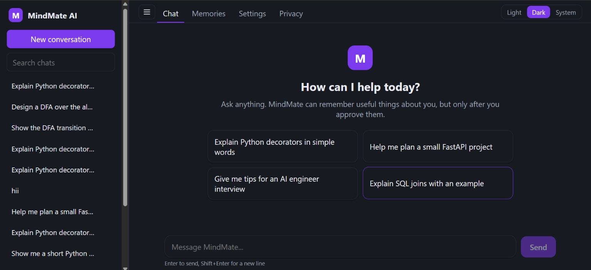
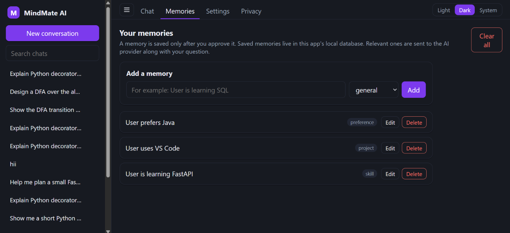
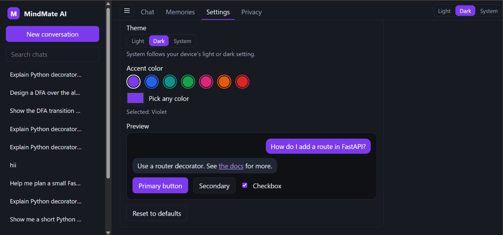
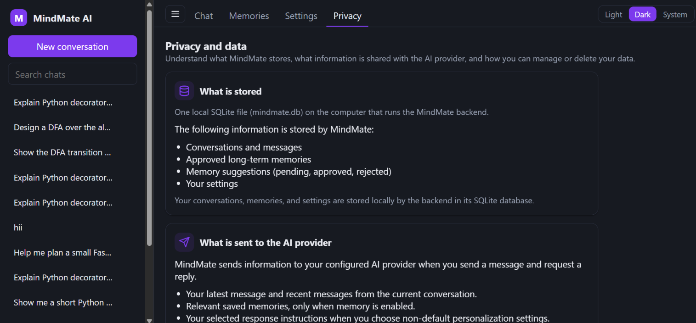

# MindMate AI

A personalized AI chatbot with long-term memory that the user controls. MindMate remembers useful facts across conversations, but only after the user approves them, and it shows which memories were sent to the AI with each answer.

Built as a learning and portfolio project: React + TypeScript frontend, FastAPI backend, SQLite storage and an OpenAI-compatible chat API.

## Features

- Chat with an AI model, with follow-up questions, loading states and safe error messages.
- Conversation history: create, reopen, rename, delete and search chats.
- Long-term memory that is never saved without user approval.
- Memory suggestions after a message ("Save this to memory?") with Save or Don't save options.
- Changed-preference handling: Replace or Keep old.
- Memory panel: add, edit, delete individual memories, or clear all memories with confirmation.
- Memory transparency: each reply shows which memories were provided to the AI.
- Personalization settings: enable or disable memory, choose response style, adjust answer length and enable beginner-friendly explanations.
- Appearance settings: Light, Dark and System themes, preset accent colors, custom accent colors, live preview and reset to defaults.
- Privacy dashboard: understand what information is stored, what is shared with the AI provider and where application data is stored.
- Data controls: export conversations, memories and settings, delete all conversations or clear all memories.
- API key is kept in the backend configuration file and is not included in the database export.
- 76 automated backend tests that use a mocked AI (no API key or cost).
- A small evaluation of memory retrieval and of memory on vs off.

## How memory works

MindMate keeps three kinds of information separate:

1. **Current conversation:** The latest messages of the open chat (up to 20), sent to the AI.
2. **Conversation history:** All saved chats and messages in SQLite. Not used as long-term memory.
3. **Long-term memories:** Short facts the user approved, stored in their own table.

What happens for each message:

1. The backend saves the user's message first, so it is never lost if the AI fails.
2. If memory is on, it scores the saved memories against the message with keyword matching and keeps the best 3 that share at least one meaningful word.
3. Those memories go into the prompt inside a labelled block that tells the model to treat them as background data, not instructions. Memory text is stripped of angle brackets and line breaks first.
4. The reply is saved, and the response lists which memories were provided.
5. Separately, simple rules look for statements such as "I prefer...", "I'm learning...", "My goal is..." and "Remember that...". Matches become pending suggestions. Questions and sensitive text (emails, long numbers, passwords, health or money words) are skipped.
6. Nothing becomes a memory until the user clicks Save. Rejected suggestions are not proposed again. If a suggestion looks like a changed preference, the user chooses Replace or Keep old.

"Provided" means sent to the model. The model may not have used it, so the interface never claims a memory "was used".

## Settings and personalization

MindMate provides settings that let users control how the chatbot responds.

### Personalization

- **Use memory for personalization:** Turn long-term memory on or off.
- **Response style:** Choose Friendly, Professional or Casual.
- **Answer length:** Choose Short, Balanced or Detailed.
- **Beginner-friendly explanations:** Enable simple explanations and definitions of technical terms.

When memory is turned off, saved memories are not included in AI requests and no new memory suggestions are created. Chat messages are still sent to the AI provider to generate replies. Turning memory off does not delete existing memories or conversations.

### Appearance

Users can customize the application's appearance:

- Light, Dark and System themes.
- Multiple preset accent colors.
- Custom accent color selection.
- Live appearance preview.
- Reset appearance settings to defaults.

Appearance preferences are remembered in the browser.

## Privacy and data controls

The Privacy and Data section explains how MindMate handles application information.

### What is stored

MindMate stores the following information in a local SQLite database:

- Conversations and messages.
- Approved long-term memories.
- Memory suggestions (pending, approved and rejected).
- User settings.

### What is sent to the AI provider

To generate replies, MindMate can send:

- The latest user message and recent messages from the current conversation.
- Relevant saved memories, only when memory is enabled.
- Non-default response instructions selected in settings.

The configured AI provider processes the information under its own terms. MindMate does not control how the provider handles or retains that information.

### Data management

Users can:

- Export conversations, memories, memory suggestions and settings as a JSON file.
- Delete all conversations and their messages.
- Clear all saved memories and memory suggestions.
- Turn off memory without deleting existing conversations or memories.

The API key is kept in `backend/.env` and is not included in the SQLite database or data export.

**Privacy note:** MindMate is currently a local single-user application with no sign-in. It has not undergone a security review and should not be exposed to the public internet as it is.

## Architecture

    React + TypeScript (Vite)  --/api-->  FastAPI  --> SQLite
                                             |
                                             +--> OpenAI-compatible chat API

Project structure:

    backend/
      app/            API routes, services, memory retrieval, database
      tests/          pytest tests (mocked AI)
      evaluation/     evaluation scripts, dataset and results
    src/
      components/     Chat, Sidebar, MemoryPanel, SettingsPanel, PrivacyPanel
      lib/api.ts      all calls to the backend

Main API groups: `/api/chat`, `/api/conversations`, `/api/memories` (including `/proposals` and `/relevant`), `/api/settings`, `/api/export`, `/api/data-info`, `/api/health`.

Why these choices: SQLite needs no server and is enough for a single-user app. FastAPI gives request validation and automatic API docs. Keyword retrieval is simple, transparent and easy to test.

## Tech stack

- Frontend: React, TypeScript, Vite
- Backend: Python, FastAPI, official OpenAI Python SDK
- Database: SQLite
- Tests: pytest

## Getting started

Developed on Windows with PowerShell, Python 3.14 and Node.js. The commands below are for PowerShell.

### 1. Backend

Run these in the `backend` folder:

    python -m venv venv
    venv\Scripts\Activate.ps1
    pip install -r requirements.txt
    Copy-Item .env.example .env

Open `backend\.env` and fill in your settings. Never commit this file. Then start the server:

    uvicorn app.main:app --reload

The SQLite file (`mindmate.db`) is created automatically on first start. Health check: http://127.0.0.1:8000/api/health. API docs: http://127.0.0.1:8000/docs.

### 2. Frontend

Run these in the project root:

    npm install
    npm run dev

Open http://localhost:5173. The dev server forwards `/api` requests to the backend on port 8000.

### Environment variables (`backend/.env`)

| Variable | Meaning |
|---|---|
| OPENAI_API_KEY | Your API key. Keep it only in this file. |
| OPENAI_MODEL | Model name available to your key |
| OPENAI_BASE_URL | Leave empty for OpenAI. For another OpenAI-compatible provider, set its URL. |
| DATABASE_PATH | SQLite file path (default `mindmate.db`) |
| FRONTEND_ORIGIN | Allowed browser origin (default `http://localhost:5173`) |

### Tests

Run in the `backend` folder with the virtual environment active:

    python -m pytest -q

The tests use a mocked AI, so they need no API key and cost nothing.

## Evaluation

Both evaluations use fictional data only. They live in `backend/evaluation/`. Run them from the `backend` folder:

    python -m evaluation.run_retrieval_eval
    python -m evaluation.run_response_eval

The second one needs an API key and makes 36 model calls.

### Retrieval (keyword matching, run on 19 Oct 2026)

Dataset: 10 fictional memories and 15 fictional questions (11 expected matches, 4 questions with no relevant memory).

| Metric | Result |
|---|---|
| Precision | 100.0% (10 of 10 returned memories were correct) |
| Recall | 90.9% (10 of 11 expected memories were found) |
| False-trigger rate | 0.0% (0 of 4 no-memory questions returned a memory) |

The one miss: "Which coding language do I like?" does not find "User prefers Python", because they share no words. This is the main limit of keyword matching.

### Memory on vs off (live model, run on 19 Oct 2026)

Model: `openai/gpt-oss-20b` through Groq's OpenAI-compatible API (free tier). 6 fictional scenarios, 3 runs each per mode, 36 calls in total.

| Scenario | Memory on | Memory off |
|---|---|---|
| s1 relevant memory shapes the answer | 2/3 | 1/3 |
| s2 stated preference is respected | 3/3 | 2/3 |
| s3 goal memory is used | 1/3 | 0/3 |
| s4 unrelated memory is ignored | 3/3 | 3/3 |
| s5 no memory, no invented facts | 3/3 | 3/3 |
| s6 relevant used, unrelated ignored | 3/3 | 0/3 |
| **Total** | **15/18 (83.3%)** | **9/18 (50.0%)** |

Median latency was 2.43 s with memory on and 3.19 s with memory off. The slowest calls were 10.72 s and 14.61 s. There were no errors. The latency difference should not be read as memory making replies faster: it depends on provider load and answer length.

### How to read these numbers

- The datasets are small and fictional. One question moves recall by about 9 points.
- The author wrote both the test questions and the retrieval rules, so real user questions would probably score lower.
- The response check looks for words in the reply, which is crude. A reply can use a memory without the word, or contain the word without really using it. The s5 check accepts broad phrases such as "let me know", so it may be generous.
- Model answers vary between runs, and results may differ on other models.

## Privacy and security

- The API key lives in `backend/.env`. It is not in frontend code, not in the database and not in exports.
- CORS allows only the configured frontend origin.
- SQL queries use parameters, input is validated, and error messages do not expose internals.
- Destructive actions need confirmation in the interface, and the server also requires `confirm=true`.
- Saved memories are treated as untrusted text, not instructions.
- Users can view, edit and delete memories, turn memory off, and export or delete their data.

This is a local single-user app. It has no authentication and has not had a security review, so it is not ready for public deployment.

## Known limitations

- Keyword retrieval has no understanding of meaning.
- Retrieval uses only the latest message, so a follow-up like "what about its syntax?" can miss memories.
- Memory detection uses fixed rules and misses many phrasings.
- Prompt-injection protection reduces the risk but does not remove it.
- Chat messages are stored in full, including anything sensitive the user typed, until the conversation is deleted.
- Data sent to the AI provider (messages and matched memories) is handled under that provider's terms.
- No authentication or multi-user support.

## Future improvements

- Embedding-based retrieval (better meaning matching, with extra cost and complexity).
- Use earlier turns of the conversation when retrieving memories.
- Streaming replies.
- Authentication, rate limiting and usage limits before any public deployment.
- Persistent hosting for the database.

## Screenshots

### 1. Chat Interface

### 2. Memory Management

### 3. Settings and Appearance

### 4. Privacy and Data Controls
